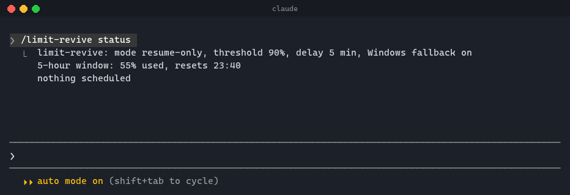
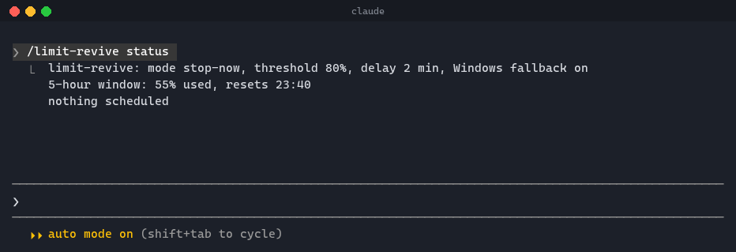

# claude-limit-revive

[](https://github.com/lucaslobasso/claude-limit-revive/actions/workflows/ci.yml)
[](CHANGELOG.md)
[](LICENSE)
[](#requirements)
[](#install)

<p align="center">
  
  
</p>

A Claude Code plugin that picks a session back up after the 5-hour usage limit resets. When the limit is close **and there is unfinished work**, it schedules a resume for the reset time plus a few minutes and then sends "continue where you left off" into the same session. Work that already finished is never "continued".

> Unofficial community project, not affiliated with Anthropic.

**[Requirements](#requirements) · [Install](#install) · [Settings](#settings) · [How it looks](#how-it-looks) · [Update](#update) · [How it works](#how-it-works) · [Troubleshooting](#troubleshooting) · [Uninstall](#uninstall) · [Install the whole set](#install-the-whole-set)**

## Requirements

- Claude Code **2.1.3xx or newer** (`claude --version`), which has the function-hook plugin API (early access; it may change between releases).
- A Claude subscription with a 5-hour usage window (Pro or Max). With API billing there is no window and the plugin stays idle.
- Windows, macOS or Linux. The optional [Windows fallback](#windows-fallback) uses Windows Terminal (`wt.exe`) when it is installed.

## Install

In a Claude Code session:

```
/plugin install limit-revive --marketplace lucaslobasso/claude-limit-revive
```

Answer `y` to add the marketplace and pick the **user** scope (every project). Or from a shell:

```sh
claude plugin marketplace add lucaslobasso/claude-limit-revive
claude plugin install limit-revive@claude-limit-revive --scope user
```

It works from the next session on. Check it with `/limit-revive status`.

## Settings

Change them in `/config` under **limit-revive**, or at install time with `--config key=value`:

| Setting | Default | Values | What it does |
| --- | --- | --- | --- |
| `thresholdPercent` | `90` | 0 to 100 | 5-hour usage percent at which the plugin gets involved |
| `delayMinutes` | `5` | minutes | How long after the reset to resume |
| `mode` | `resume-only` | `resume-only` / `finish-turn` / `stop-now` | See below |
| `resumePrompt` | `The usage limit has reset. Continue exactly where you left off.` | text | What is sent to the session when it resumes |
| `windowsFallback` | `true` | true / false | Windows only: also schedule a task that reopens the session if its window was closed |

**Modes:**

- `resume-only` (default): never interrupts. Only a turn that died at the limit is resumed.
- `finish-turn`: lets the running turn finish, holds prompts you type over the threshold, and sends them after the reset.
- `stop-now`: stops the running turn at the threshold to save what is left of the window, and resumes it after the reset.

**Commands:**

| Command | What it does |
| --- | --- |
| `/limit-revive status` | Settings, the current 5-hour reading, and what is scheduled |
| `/limit-revive cancel` | Drops the scheduled resume (and any held prompt); the plugin stays out of the way until the window resets |
| `/limit-revive now` | Resumes right away instead of waiting |

## How it looks

| | |
| --- | --- |
| **Defaults**, nothing scheduled | **`mode=stop-now`, `thresholdPercent=80`, `delayMinutes=2`** |
|  |  |

While a resume is scheduled, the status bar shows `⏸ revive at 14:05 (turn stopped at the limit)` and `/limit-revive status` adds the time and reason.

<sub>Screenshots are real Claude Code sessions captured offscreen (see [Contributing](#contributing)).</sub>

## Update

```sh
claude plugin marketplace update claude-limit-revive
claude plugin update limit-revive@claude-limit-revive
```

See [CHANGELOG.md](CHANGELOG.md) for what changed.

## How it works

1. Every usage reading (`session.measure`) updates the 5-hour percent and reset time.
2. When a turn ends at the limit, or the threshold is passed in `finish-turn` / `stop-now` mode, the plugin arms a timer for **reset + `delayMinutes`** and shows it in the status bar.
3. A turn that finishes normally, or a prompt you type, cancels the timer: there is nothing left to continue.
4. When the timer fires and the window really has reset, it submits `resumePrompt` (or your held prompt). If usage is still high with a new reset time, it re-arms instead.

### Windows fallback

With `windowsFallback` on, Windows also gets a one-shot Task Scheduler job (`ClaudeLimitRevive_<id>`) 2 minutes after the in-session timer. It opens Windows Terminal with `claude --resume <session> "<prompt>"`, so the session comes back even if its window was closed. A background session (agent view, `claude --bg`) is continued in the background instead, with `claude --bg --resume <session> "<prompt>"` and no window. The in-session timer deletes the job before resuming, and the job deletes itself after it runs. On macOS and Linux the setting is ignored.

Background sessions depend on this fallback: Claude Code retires an idle background session after about an hour, and the in-session timer ends with it. Without the task (the setting off, or macOS and Linux) a background session resumes only if the reset comes before it is retired.

## Troubleshooting

- **`/limit-revive` is an unknown command.** Start a new session after installing, and check that `claude plugin list` shows `limit-revive` enabled.
- **"5-hour window: no reading yet".** Claude Code reports usage after the first reply of a session. Send any prompt.
- **It didn't resume.** It only resumes unfinished work: a turn that finished normally cancels the timer by design. `/limit-revive status` shows what is scheduled.
- **"Windows task not scheduled".** PowerShell or Task Scheduler refused the job (some managed PCs block it), or `claude` is not on your PATH. The in-session timer still works while the window stays open; set `windowsFallback` to false to stop the notice.
- **A session opened by itself.** That is the Windows fallback reviving a session whose window was closed. Turn off `windowsFallback` if you don't want it.

## Uninstall

```sh
claude plugin uninstall limit-revive@claude-limit-revive
claude plugin marketplace remove claude-limit-revive
```

A Windows task that is already scheduled expires by itself; to remove it now: `Get-ScheduledTask ClaudeLimitRevive_* | Unregister-ScheduledTask -Confirm:$false`.

<!-- bundle:start (copied from claude-launcher/docs/bundle-section.md; edit it there and copy to all six READMEs) -->
## Install the whole set

This is one of six small tools that work well together. Each installs on its own, or get them all with one command:

| Tool | What it does | Runs on |
| --- | --- | --- |
| [Claude Launcher](https://github.com/lucaslobasso/claude-launcher) | One click from the taskbar or Start menu straight into Claude Code, with a Claude icon and a loading spinner | Windows |
| [Claude Taskbar](https://github.com/lucaslobasso/claude-taskbar) | Your Claude sessions and usage limits as dots and bars on the Windows taskbar | Windows |
| [boxed-messages](https://github.com/lucaslobasso/claude-boxed-messages) | Colored boxes around your prompts and Claude's replies | Any |
| [claude-statusline](https://github.com/lucaslobasso/claude-statusline) | A status line with model, context, branch, and usage only when it gets high | Any |
| [limit-revive](https://github.com/lucaslobasso/claude-limit-revive) | Resumes an unfinished session after the usage limit resets | Any |
| [language-spinner](https://github.com/lucaslobasso/claude-language-spinner) | The "thinking" spinner shows words in a language you are learning | Any |

**Windows** (PowerShell 7):

```powershell
irm https://raw.githubusercontent.com/lucaslobasso/claude-launcher/main/bundle.ps1 | iex
```

To pick, pass options: `-Only statusline,limit-revive`, `-Skip launcher`, `-List` (show what is installed) or `-Uninstall`:

```powershell
& ([scriptblock]::Create((irm https://raw.githubusercontent.com/lucaslobasso/claude-launcher/main/bundle.ps1))) -Skip taskbar
```

**macOS and Linux:** the four plugins work everywhere. In a shell:

```sh
for p in boxed-messages statusline limit-revive language-spinner; do
  claude plugin marketplace add "lucaslobasso/claude-$p"
  claude plugin install "$p@claude-$p" --scope user
done
```
<!-- bundle:end -->

## Contributing

```sh
git clone https://github.com/lucaslobasso/claude-limit-revive
cd claude-limit-revive
claude --plugin-dir .            # try your changes in a session
claude plugin test .             # tests (hooks/*.test.ts)
claude plugin validate .         # manifest and hooks check
```

- Loading the plugin once writes its type declarations to `.claude-plugin/types/` (git-ignored), which `tsconfig.json` uses for editor type checking.
- `python docs/screenshots.py` retakes the screenshots offscreen (needs `pip install pyte pillow pywinpty`; uses your login in a throwaway config folder).

## License

[MIT](LICENSE) © Lucas Lobasso
